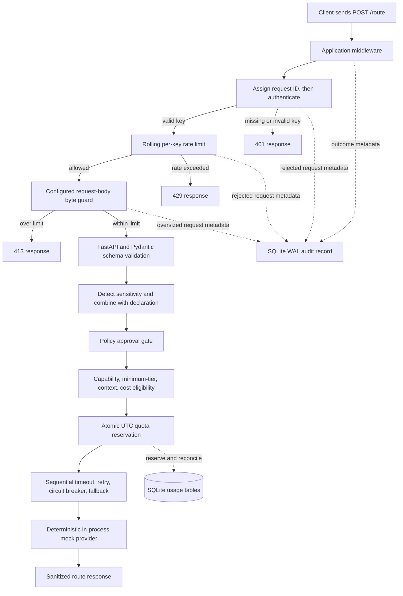

# Intelligent Model Router

A small FastAPI portfolio project that demonstrates **rule-based, policy-aware model routing**. It is not a trained machine-learning router. The default provider is deterministic mock behavior, so requests do not reach a hosted LLM or leave the process.

## One-minute overview

The API accepts a task, prompt, and declared sensitivity. It detects a few common sensitive-data patterns, uses whichever sensitivity is stricter, and applies the model approval policy before selecting by task capability, context fit, minimum tier, and illustrative estimated cost. The request then passes through bounded retry, fallback, and a per-provider circuit breaker. API-key authentication, usage limits, and SQLite metadata-only request records wrap the route.

The code is deliberately small enough to follow and test. Start with [the project plan](intelligent_model_router_final_project_plan.md) for the broader design and [progress notes](progress.md) for the milestone history.

## Architecture and request flow

This is a modular monolith: one FastAPI application with separate modules for policy/routing, providers, reliability, usage accounting, and audit records.



An unapproved effective sensitivity returns `403` before any provider call. The API key is supplied in `X-API-Key`; `/health` is public.

## Implemented features

- Tasks: classification, extraction, summarization, reasoning, and coding. Minimum tiers are small for classification/extraction, medium for summarization, and large for reasoning/coding.
- Sensitivity levels: public, internal, confidential, restricted. Email/phone patterns raise sensitivity to at least internal; likely card numbers, Aadhaar-like numbers, PAN-like values, and obvious API-key patterns raise it to restricted. These heuristics are not complete DLP. No configured mock model is approved for restricted data.
- Deterministic model selection from `models.yaml`; demo model identifiers, context windows, capabilities, and prices are synthetic values, not verified provider specifications.
- Mock provider output is fixed by task and does not echo prompts. No hosted provider integration is implemented.
- Provider timeout defaults to 15 seconds; one delayed retry and one eligible fallback are allowed. Circuit breakers open after three retryable logical failures, cool down for 30 seconds, then admit one half-open trial. State is in process.
- `POST /route` requires a configured API key. The per-key rolling rate limit defaults to 30 requests per 60 seconds. UTC daily limits default to `$1.00` estimated cost and 10 requests involving a large-tier model. SQLite WAL stores request metadata and quota accounting, not prompts, keys, or provider output.
- Authenticated `POST /route` bodies are limited by `ROUTER_MAX_REQUEST_BODY_BYTES` (default 65,536 bytes); oversized bodies receive a small `413` response before JSON/schema parsing.
- The benchmark compares 50 synthetic public prompts with a fixed policy-permitted `mock-large` baseline. It estimates cost only; it does not measure model quality or real inference.

## Setup on Windows PowerShell

Use Python 3.11 or newer. From the repository root:

```powershell
py -3 -m venv .venv
.\.venv\Scripts\Activate.ps1
python -m pip install -r requirements.txt
$env:ROUTER_API_KEYS = "local-demo-key"
$env:ROUTER_DATABASE_PATH = "router_audit.sqlite3"
```

`local-demo-key` is a throwaway local example, not a project-provided credential. Choose your own local value and do not publish it. `POST /route` has no default key configured, so it returns `401` until `ROUTER_API_KEYS` is set. Multiple keys can be comma-separated. Production environment configuration rejects an empty key list.

| Environment variable | Default | Purpose |
| --- | --- | --- |
| `ROUTER_API_KEYS` | empty | Comma-separated accepted API keys |
| `ROUTER_ENVIRONMENT` | `development` | `development`, `test`, or `production` |
| `ROUTER_APP_NAME` | `Intelligent Model Router` | FastAPI application title |
| `ROUTER_PROVIDER_TIMEOUT_SECONDS` | `15` | Per-provider-call timeout |
| `ROUTER_PROVIDER_RETRY_DELAY_SECONDS` | `1` | Delay before the bounded retry |
| `ROUTER_RATE_LIMIT_REQUESTS` | `30` | Requests in the rolling window per key |
| `ROUTER_RATE_LIMIT_WINDOW_SECONDS` | `60` | Rolling rate-limit window |
| `ROUTER_DAILY_COST_LIMIT_USD` | `1` | UTC-day estimated-cost cap per key |
| `ROUTER_DAILY_LARGE_TIER_LIMIT` | `10` | UTC-day large-tier cap per key |
| `ROUTER_DATABASE_PATH` | `router_audit.sqlite3` | SQLite audit and usage database |

After authentication and rate limiting, the body-size middleware rejects a single valid `Content-Length` above the configured cap immediately. It also counts actual ASGI body bytes when the header is absent, malformed, duplicated, or understates the body, then replays only an in-limit body to FastAPI by reusing references to the received chunks rather than copying the complete body. The middleware bounds the body bytes it accumulates to the configured limit; it cannot control buffering by an upstream server/proxy or allocation of an ASGI chunk already delivered, and this is not a strict process-memory cap. Prompt length (20,000 characters) and output allowance (2,048 tokens) remain fixed in the request schema; settings parse `ROUTER_MAX_PROMPT_CHARS` and `ROUTER_MAX_OUTPUT_TOKENS`, but those overrides are not wired into the schema. The guard rejects as soon as a chunk takes the accumulated total over the limit.

## Run and verify

Start the local API:

```powershell
.\.venv\Scripts\python.exe -m uvicorn app.main:app --reload
```

Run the full suite:

```powershell
.\.venv\Scripts\python.exe -m pytest -q
```

Run the benchmark:

```powershell
.\.venv\Scripts\python.exe scripts\run_benchmark.py
```

The benchmark writes deterministic JSON to `benchmark_results.json`. Change the output with `--output another-file.json`.

## API examples

Check the public health endpoint:

```powershell
Invoke-RestMethod -Method Get -Uri http://127.0.0.1:8000/health
```

Example response:

```json
{"status":"ok"}
```

Route a synthetic public classification request:

```powershell
$headers = @{ "X-API-Key" = $env:ROUTER_API_KEYS }
$body = @{
    prompt = "Classify this fictional item: blue widget."
    task_type = "classification"
    sensitivity = "public"
} | ConvertTo-Json
Invoke-RestMethod -Method Post -Uri http://127.0.0.1:8000/route `
    -Headers $headers -ContentType "application/json" -Body $body
```

The response follows `RouteResponse`; for the mock provider it includes fields such as `output` (`mock-classification`), `model_used` (normally `mock-small` for this public classification), `final_sensitivity`, `decision_reason`, `fallback_used`, `latency_ms`, `estimated_cost_usd`, `input_tokens`, `output_tokens`, `retry_count`, and `attempt_count`. Measured latency varies per run. Invalid or missing credentials return `401`; oversized authenticated route bodies return `413`; policy denial returns `403`; invalid or ineligible requests return `422`; rate/quota denials return `429`; provider failures use sanitized `502`, `503`, or `504` responses.

## Synthetic benchmark result

| Comparison | Estimated total |
| --- | ---: |
| Rule-routed models | `$0.0164486` |
| Fixed `mock-large` baseline | `$0.0348275` |
| Difference | `$0.0183789` (`52.77123%`) |

The benchmark uses 50 artificial public prompts (10 for each task), illustrative `models.yaml` prices, and the approximate `ceil(prompt characters / 4)` estimator. Both sides use the same dataset and output-token assumptions; the baseline is counted only when the fixed model is approved and capable. Its labels check expected minimum tier, not generated answer quality. These are synthetic cost estimates, **not** measured real provider savings, answer quality, latency, or invoice costs. See [benchmark dataset notes](benchmark-data/README.md) and the generated [results file](benchmark_results.json).

## Limitations

- Sensitivity detection is heuristic and can miss sensitive content; it is not complete DLP.
- The deterministic mock does not perform language-model inference. Its outputs cannot establish quality or real-world routing effectiveness.
- Prices, context windows, and model capabilities are illustrative. Character-count token estimates are approximate.
- Rate limits and circuit breakers are in memory and reset on restart; they are not shared across workers. SQLite usage reservations are transaction-backed locally, but this is not a distributed deployment design.
- The body guard limits bytes consumed and retained by this application after authentication; it does not bound buffering by an upstream reverse proxy/server or the size of one ASGI event already delivered to the app.
- Audit records contain operational metadata, including pseudonymous key identifiers; metadata can still be sensitive. No raw prompt, API key, or raw provider response is stored.
- This project is a learning/portfolio implementation, not production-ready infrastructure.

## Repository map

```text
app/                  FastAPI, schemas, config, routing, providers, reliability, usage, audit, benchmark
tests/                Unit and end-to-end tests
models.yaml           Illustrative model catalog and approval policy
benchmark-data/       50-case synthetic benchmark dataset and notes
scripts/              Benchmark command-line runner
benchmark_results.json Reproducible synthetic benchmark output
docs/                 Architecture and placement interview guides
progress.md           Milestone history and verification results
intelligent_model_router_final_project_plan.md
                      Detailed source plan and implementation roadmap
```

Further reading: [architecture details](docs/ARCHITECTURE.md), [placement interview preparation](docs/PLACEMENT_INTERVIEW.md), [project plan](intelligent_model_router_final_project_plan.md), and [progress history](progress.md).
