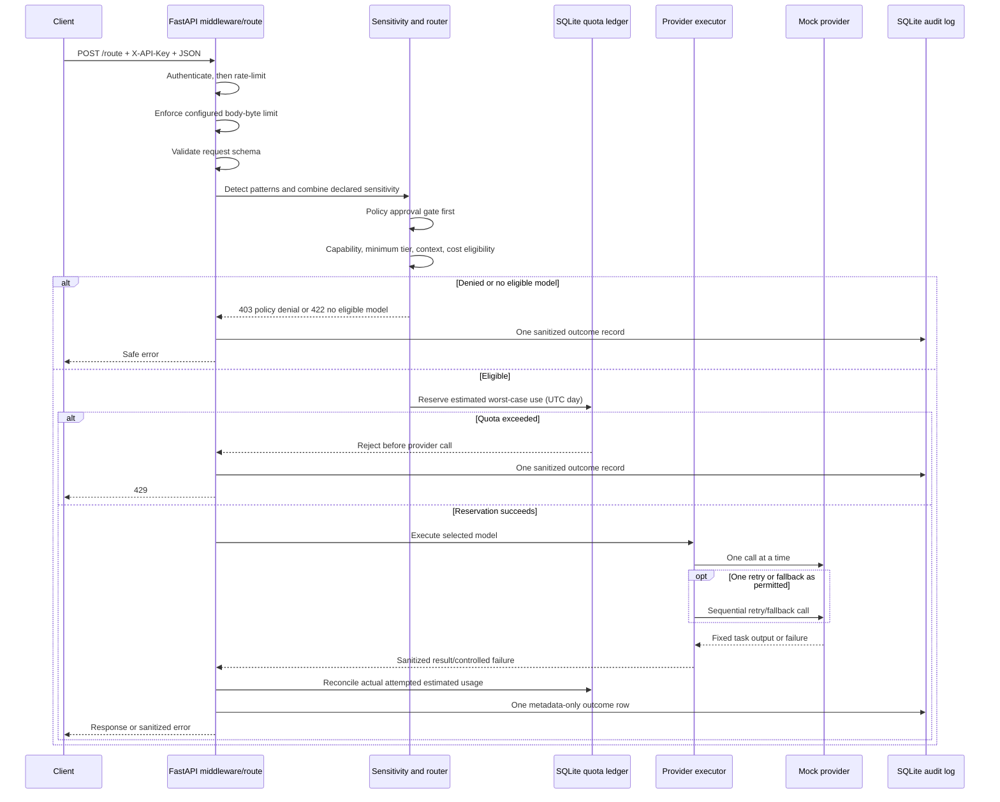

# Architecture and request lifecycle

The router is a **rule-based modular monolith**. FastAPI exposes the API while focused modules handle model metadata, sensitivity checks, eligibility, provider execution, quotas, and audit persistence. The default provider is a deterministic mock; the current project does not perform hosted-model inference.

## Components

| Component | Responsibility |
| --- | --- |
| `app/main.py` | Creates the FastAPI application and wires route flow, middleware, provider executor, quotas, and audit logging. |
| `app/schemas.py` | Pydantic task, sensitivity, request, and response types. Prompt length and output token maximums are fixed in these schemas. |
| `app/config.py` | Loads and validates environment settings. |
| `models.yaml`, `app/model_config.py` | Demo model catalog loaded with YAML `safe_load` and validated with Pydantic. Metadata is illustrative. |
| `app/sensitivity.py` | Heuristic email, phone, card, Aadhaar-like, PAN-like, and API-key-pattern checks. |
| `app/router.py` | Policy-first ranking, minimum-tier/capability/context checks, deterministic cost estimate and tie-breaking. |
| `app/providers.py` | Provider protocol, typed provider failures, and deterministic in-process mock. |
| `app/reliability.py` | Sequential provider timeout, retry, fallback, and per-provider-instance circuit breakers. |
| `app/usage.py` | API-key comparison and pseudonymous IDs, rolling in-memory rate limiter, and transaction-backed quota reservation/reconciliation. |
| `app/audit_log.py` | SQLite WAL schema and one metadata-only request audit row. |
| `app/benchmark.py` | Reproducible, provider-free synthetic cost comparison. |

## Request lifecycle

Authentication and rate limiting run before the body guard; FastAPI validates the endpoint schema only after the guard accepts the body. The guard fast-rejects a single parseable `Content-Length` above the configured limit. Otherwise it counts received ASGI body bytes, including chunked bodies, and stops on the first chunk that takes the total over the cap. It stores references to nonempty received chunks and replays them once, avoiding a second complete-body copy. The bytes accumulated by this middleware are bounded by the configured limit. This is not a process-memory cap: the ASGI server may allocate a chunk before delivery, and server/framework overhead is outside the guard. Oversized authenticated `POST /route` requests return `413` with a fixed message and are audit-recorded once; they do not reach schema parsing, quota reservation, or a provider. `GET /health` is unaffected.

After the body guard accepts a request, the route detects sensitivity and calls `rank_models`. The policy gate filters approval first; only then does the router filter task capability, minimum tier, context fit, and request cost ceiling. This prevents an inexpensive but unapproved model from being considered.

The task minimum tiers are classification/extraction: small; summarization: medium; reasoning/coding: large. Eligible candidates are sorted by estimated cost, then tier, then model identifier for deterministic tie-breaking. The estimates use `ceil(prompt characters / 4)` input tokens and catalog prices per million tokens; output cost uses the requested output allowance for routing.

After eligibility, the API reserves conservative cost for the primary sequence and one possible fallback, plus a large-tier slot if either candidate is large. A failed reservation returns `429` before provider invocation. On completion or controlled provider failure, the reservation is reconciled with models actually attempted; unused reservation is released. One incoming API request is one quota unit even when it causes retry/fallback calls.

## Reliability behavior

- Each provider call has a default 15-second timeout.
- Only transient failures/timeouts are retried, at most once, after the configured default one-second delay. Ordinary permanent/provider 4xx failures are not retried.
- At most one fallback is considered, sequentially. The executor recomputes the eligible ranking for the same effective sensitivity before selecting the next eligible candidate. A retry already used on the primary means the fallback is not retried; if the primary was skipped because its circuit is open, the fallback may use one retry.
- Each provider instance has a lock-protected breaker. It opens after three consecutive retryable logical execution failures. After the 30-second cooldown one half-open trial is admitted; success closes/reset it, while retryable trial failure reopens it.
- Retry attempts count as one logical breaker outcome, based on the final result of the retry sequence.

The provider executor never calls models concurrently for one request. These controls are in-process and reset when the process restarts. Separate workers do not share breaker state; there is no distributed coordination. A timed-out async task is cancelled, but a future provider adapter would need to consider whether work already sent remotely can continue.

## Authentication, quotas, and audit data

`POST /route` requires `X-API-Key`. Accepted keys come from comma-separated `ROUTER_API_KEYS`; comparisons use `hmac.compare_digest`, and downstream accounting uses a SHA-256 pseudonymous identifier rather than the raw key. Missing/invalid credentials return `401` without provider invocation. `GET /health` is public.

The rolling default limit is 30 authenticated requests per key per 60 seconds. Rejected requests do not consume another rate-limit slot. The limiter is lock-protected in one process and resets on restart. Daily limits use UTC calendar dates and SQLite `BEGIN IMMEDIATE` transactions to reserve `$1` estimated cost and 10 large-tier requests per key by default. The daily large slot is conservatively reserved when a primary or fallback candidate is large. These are estimate-based controls, not a billing system.

SQLite uses WAL mode. `request_audit` records request ID, pseudonymous key ID, UTC timestamp, task, effective sensitivity, selected model/tier, status, attempts/retries/fallback, estimated tokens/cost, latency, and a sanitized failure category. It does **not** store a prompt hash, raw prompt, prompt fragment, API key, provider output, credential, or stack trace. The local database is ignored by Git via the existing ignore rules. Metadata itself can still carry privacy risk.

## Current limitations

- Pattern detection is heuristic, not complete DLP; restricted data is denied because the current mock catalog has no restricted approval.
- Model IDs, capabilities, context sizes, prices, token counts, and costs are illustrative. The mock's task labels do not indicate generated quality.
- `ROUTER_MAX_REQUEST_BODY_BYTES` is enforced by the ASGI body guard, which bounds its accumulated body chunks but does not cap total process memory. It cannot control buffering by an upstream proxy/server before an ASGI event reaches the app, or the size of a single event already delivered. `Settings` parses `ROUTER_MAX_PROMPT_CHARS` and `ROUTER_MAX_OUTPUT_TOKENS`, but the request schema still uses fixed 20,000-character and 2,048-token limits rather than those overrides.
- Rate limiting and circuit breakers are process-local. SQLite transactions protect local quota reservations, but no distributed rate-limit or breaker service exists.
- The benchmark reports synthetic routing label checks and estimated costs only. It does not evaluate answer quality, real inference cost, latency, or invoice savings.

See the root [README](../README.md), [project plan](../intelligent_model_router_final_project_plan.md), and [milestone history](../progress.md).
